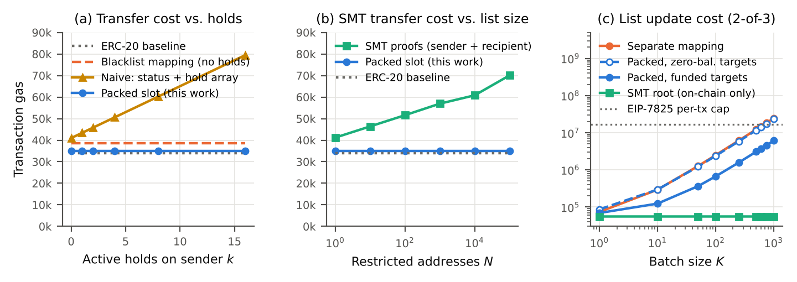

# stablecoin-compliance-controls

Reference implementation, safety tests, and gas benchmarks for **ledger-level compliance controls for payment stablecoins**: block, freeze, reject, hold, seize, and burn, as required of permitted payment stablecoin issuers under the U.S. GENIUS Act (Pub. L. 119-27).

This repository accompanies the paper:

> Meng Wang. *Ledger-Level Compliance Controls for Payment Stablecoins: A Reference Architecture for Block, Freeze, and Reject Capabilities under the GENIUS Act.* Preprint, 2026.

> [!WARNING]
> Research code. It has **not been audited** and is not intended for production deployment.

## Key results



All values are full transaction gas (base cost + calldata + execution − capped refunds), measured with Foundry in isolated-transaction mode.

| Scenario | Tx gas | vs. baseline |
|---|---:|---:|
| ERC-20 transfer, no compliance logic | 33,980 | — |
| **Transfer, packed design (this work), any number of active holds** | **35,034** | **+3.1%** |
| Transfer, separate blacklist mapping | 38,478 | +13.2% |
| Transfer, separate status + aggregate held amount, any number of holds | 40,906 | +20.4% |
| Transfer, separate status + hold array, 0 / 16 holds | 40,975 / 79,487 | +20.6% / +134% |
| Transfer with SMT non-membership proofs, N = 1 / 100,000 | 41,193 / 70,060 | +21% / +106% |

| Compliance action (2-of-3 quorum unless noted) | Tx gas |
|---|---:|
| Freeze, single key (zero-balance account) | 57,611 |
| Freeze, 2-of-4 quorum (zero-balance account) | 85,157 |
| Each additional required signer | ≈ +6,750 |
| Freeze / unfreeze (funded account) | 68,081 / 68,069 |
| Place hold | 91,752 |
| Seize full hold (to a custody account) | 75,476 |
| Burn part of a hold | 81,941 |
| Release hold | 64,142 |
| Update SMT root (any batch size) | ≈ 55,450 |

Batch blocking through a separate mapping exceeds the EIP-7825 per-transaction cap (2²⁴ = 16,777,216 gas) at roughly **690 addresses** per transaction. Raw data is in [`results/`](results/).

## Design

| Contract | Role |
|---|---|
| [`EnforcedToken`](src/EnforcedToken.sol) | **Proposed design.** Each account's balance (`uint128`), aggregate held amount (`uint120`), and status (`uint8`) share one storage slot, so a transfer reads compliance state at no extra storage cost. Holds are individually identified records. Seize and burn can only debit an existing hold (two-phase enforcement), and seize can only credit a designated custody account (`isCustody`, set at deployment and changed only by the authority). Every compliance action extends a hash-chained audit log. |
| [`ComplianceAuthority`](src/ComplianceAuthority.sol) | M-of-N signature quorum over an EIP-712 digest that binds the target, exact calldata, an evidence hash (e.g. a reference to a lawful order), a nonce, and a deadline. It is the only address allowed to change compliance state. |
| [`BridgedEnforcedToken`](src/BridgedEnforcedToken.sol) | `EnforcedToken` plus the ERC-7281 bridge interface for issuer-controlled burn-and-mint bridging: bridge-out and bridge-in apply the same compliance checks as transfers, and each allow-listed bridge has rate-limited minting and burning. See [Cross-chain bridging](#cross-chain-bridging). |
| [`XChainAdapter`](src/XChainAdapter.sol) | Minimal allow-listed bridge adapter used in the two-chain tests and benchmarks. |
| [`TieredAuthority`](src/TieredAuthority.sol) | Asymmetric authority of paper Section 5.5: a fast tier for restrictive actions and a delayed, guardian-cancellable slow tier for everything else, with per-epoch budgets, signer rotation, role coverage and HSM-attestation hashes. See [Tiered authority](#tiered-authority). |
| [`BaselineToken`](src/BaselineToken.sol) | Plain ERC-20; cost reference. |
| [`BlacklistToken`](src/BlacklistToken.sol) | Comparison: classic blacklist stored in a separate mapping. |
| [`AggregateHoldsToken`](src/AggregateHoldsToken.sol) | Comparison: separate status mapping plus one aggregate held amount per account (ERC-3643-style partial-freeze bookkeeping); constant-cost transfer path. |
| [`NaiveHoldsToken`](src/NaiveHoldsToken.sol) | Comparison: separate status mapping plus a per-account array of holds summed on every transfer. |
| [`SMTToken`](src/SMTToken.sol) | Comparison: restricted set committed as a depth-160 Sparse Merkle Tree root; every transfer carries compressed non-membership proofs for sender and recipient. |

Account states:

| Status | Outbound | Inbound |
|---|---|---|
| `ACTIVE` (0) | allowed (up to balance − held) | allowed |
| `FROZEN` (1) | blocked | allowed (receive-only) |
| `BLOCKED` (2) | blocked | blocked |

## Tiered authority

`TieredAuthority` can replace `ComplianceAuthority` as the token's authority. `EnforcedToken` is unchanged.

| Tier | Actions | Authorization | Timing |
|---|---|---|---|
| Fast (`execute`) | Restrictive and reversible only: `setStatus` that strictly raises restriction (Active < Frozen < Blocked), `blockBatch`, `placeHold`, `setLimits` that raises neither of a bridge's limits, and `setCustody` that removes a custody account | M_r signatures covering at least `rolesR` roles | Immediate; at most `restrictBudget` accounts restrained per epoch |
| Slow (`queue` → `executeQueued`) | Everything else: unfreeze, unblock, release, seize, burn, adding a custody account, any other target, and every configuration change | M_i > M_r signatures covering at least `rolesI` roles | Executable in [eta, eta + 14 days], eta = queue time + `delay` (≥ 1 h); a disjoint guardian quorum can cancel before execution; seized + burned value capped per epoch, for any target |

Classification happens at execution time and fails closed: anything the fast tier does not recognise as restrictive is rejected there. Configuration (signer rotation, guardians, quorums, roles, delay, budgets) can only be changed by the authority itself, i.e. through the slow tier, and every change must leave a satisfiable policy with 1 ≤ M_r < M_i ≤ N, enough distinct roles, a non-empty guardian quorum and a delay of at least one hour. Signers and guardians are disjoint. The authority binds once to a token that names it as its authority; fast-tier classification and the restriction budget apply to that token, while the value budget counts seizures and burns on any target, so a second token, or a token before binding, cannot escape it. Each signer is registered with a role and the hash of its HSM key attestation; events list the approving signers.

Measured transaction gas (fast tier 2-of-5, slow tier 3-of-5 over two roles, guardians 2-of-3; [`results/tiered.csv`](results/tiered.csv)):

| Action | Tx gas | Same action via `ComplianceAuthority` (2-of-N) |
|---|---:|---:|
| Fast freeze, zero-balance account | 104,531 | 85,157 |
| Fast freeze, funded account | 87,443 | 68,081 |
| Fast place hold | 109,659 | 91,752 |
| Slow seize: queue + execute | 88,584 + 60,713 | 75,476 (no delay) |
| Slow unfreeze: queue + execute | 88,027 + 52,914 | 68,069 (no delay) |
| Guardian cancel (2-of-3) | 37,440 | — |

The fast tier costs about 17,900–19,400 gas more per action than the single-threshold gate: it reads the target's current status to classify the action, updates the budget counter, and logs the approvers.

Proved with Halmos (`test/TieredHalmos.t.sol`, `halmos --contract TieredProofs --loop 3`), with `ecrecover` abstracted so that every outcome of signature recovery is covered, and with the authority's and token's entire storage symbolic (including every slot the constructor wrote):

- **T1** the fast tier only restricts: no status is lowered, no held amount reduced, no balance or supply changed, no existing hold touched, no bridge limit raised, no custody account added, nothing queued; it needs at least M_r approvals covering at least `rolesR` distinct roles, and stays within the restriction budget, which is charged one unit per restrained account (one per address of a `blockBatch`);
- **T2** the fast tier rejects every other target and every non-restrictive selector;
- **T3** queuing needs at least M_i approvals covering at least `rolesI` distinct roles, and sets eta = now + delay;
- **T4** a queued action executes once, only within [eta, eta + grace];
- **T5** a cancelled action never executes, and cancelling needs the guardian quorum;
- **T6** seized plus burned value never exceeds the per-epoch value budget, whatever the target: the bound token, a token not yet bound, or any other contract;
- **T7** configuration changes only through the authority itself and always leaves a valid policy; signers and guardians stay disjoint; and the signer, role and guardian counters behind the policy bounds change exactly with the membership they count, so the bounds refer to the real signer and guardian sets.

Unit tests (`test/Tiered.t.sol`, 26 tests) cover each tier boundary, adding and removing custody accounts, delay and grace, cancellation, both budgets and raising them, the value budget for a second or not-yet-bound token, rotation with attestation hashes, role coverage, disjointness, token binding, and signatures after a chain-id change.

## Cross-chain bridging

`BridgedEnforcedToken` implements the bridge-facing part of [ERC-7281](https://github.com/ethereum/ERCs/blob/master/ERCS/erc-7281.md): the issuer deploys one canonical token per chain, and allow-listed bridges burn on the source chain and mint on the destination. No collateral is locked and no wrapped token is created, so value on every chain stays under the issuer's controls.

- **Bridge-out** (`burn`) applies the outbound-transfer rules: the holder must be `ACTIVE`, only the spendable balance can leave (held value stays), and a `BLOCKED` bridge cannot burn.
- **Bridge-in** (`mint` by a bridge) applies the inbound-transfer rule: no minting to a `BLOCKED` account. A `FROZEN` account can still receive. A `BLOCKED` bridge cannot mint, so blocking a bridge shuts it in both directions.
- **Rate limits.** Each bridge has a minting limit and a burning limit that refill linearly over one day, as in ERC-7281. They bound what a compromised bridge or relayer can mint. Limits are set only by the authority, and each change is logged in the compliance hash chain.
- **Changing limits through the tiered authority.** Lowering a limit, for example to 0 to shut a compromised bridge, is a fast-tier action. Raising one is a slow-tier action.

ERC-7281 does not synchronize restrictions across chains. Each chain therefore has its own `TieredAuthority` with the same signer set, and signers sign one action per chain. The EIP-712 domain binds the chain id and the authority's address, so a signature cannot be replayed on another chain. The two-chain tests (`test/Bridge.t.sol`, 17 tests; chains simulated by switching `block.chainid`) show the following:
- Supply is conserved across a round trip.
- Holders who are frozen or blocked, and value under hold, cannot leave a chain.
- A blocked bridge can neither burn nor mint.
- Recipient status is enforced on arrival.
- Allowances and allow-listing are required.
- Rate limits refill over time.
- A bridge can be shut down through the fast tier and reopened only through the slow tier.
- A restriction on one chain does not reach the other until it is propagated.
- Signatures and queued actions cannot be replayed across chains.
- Funds that escaped before a freeze stay reachable on the destination chain.

Measured transaction gas ([`results/bridge.csv`](results/bridge.csv)):

| Action | Tx gas |
|---|---:|
| Bridge-out through the adapter (burn) | 56,349 |
| Bridge-in through the adapter (mint) | 47,552 |
| Plain transfer on the bridged token | 35,034 (same as `EnforcedToken`) |
| Fast-tier bridge shutdown, 2-of-5 | 97,953 |

Proved with Halmos (`test/BridgedHalmos.t.sol`, `halmos --contract BridgedProofs`). All thirteen `EnforcedToken` checks are re-run against the bridged token. In addition:
- **B1:** bridge-out happens only through an allow-listed, unblocked bridge within its burning limit. The holder is `ACTIVE`, at most the spendable balance leaves, held value and all other state are untouched, and supply falls by exactly the amount burned. A bridge other than the holder spends exactly the amount from the holder's finite allowance.
- **B2:** bridge-in happens only through an allow-listed, unblocked bridge within its minting limit, never to a `BLOCKED` account, and supply rises by exactly the amount minted.
- **B3:** limits change only through the authority. Each change keeps the available value within the new maxima and appends exactly the specified log entry.

`TieredProofs` additionally proves that the fast tier can never raise a bridge limit (`check_fastBridgeLimits`).

## Sanctions-list ingestion

[`scripts/sanctions_ingest.py`](scripts/sanctions_ingest.py) is the off-chain tool of paper Section 5.3. It turns an OFAC SDN publication into reviewable `blockBatch` actions that fit in a transaction. It signs nothing and submits nothing. Dual-control review, and the decision to sign, remain human steps.

```bash
# reviewer A: build from two independently retrieved copies (two formats, two parsers)
python3 scripts/sanctions_ingest.py build \
  --source <SDN.XML file or https URL> --source <SDN_ADVANCED.XML file or https URL> \
  --previous applied/manifest.json --protect protect.json [--fast-budget N] \
  [--rpc https://... --token 0x...] --out update/
# reviewer B: fetch the sources independently and recompute
python3 scripts/sanctions_ingest.py verify --source ... --source ... \
  --previous applied/manifest.json --protect protect.json --manifest update/manifest.json
```

The table maps each check to the adversary it addresses (paper, Section 3.2).

| Check | Behaviour | Addresses |
|---|---|---|
| Independent copies | At least two sources; every source must yield exactly the same address set. By default these are SDN.XML and SDN_ADVANCED.XML, read by separate parsers. | A3 (feed poisoning) |
| Transport and parsing | HTTPS only, with certificate verification. SHA-256 of every source is recorded. XML with `DOCTYPE`/`ENTITY` is rejected. Size is bounded. | A3 |
| Exact matching | Only `0x` + 40 hex digits is accepted. Mixed-case addresses must pass EIP-55. A malformed or bad-checksum entry stops the build; nothing is dropped silently. Matching is never by similarity. Non-EVM entries under shared tickers (e.g. USDT on Tron) are counted and skipped. | A5 |
| Protected addresses | Any issuer address (custody, authority, bridges) in the list stops the build. | A5 |
| Look-alikes | Additions that share their first and last four hex digits with a known or protected address are flagged for reviewers. | A5 (address poisoning) |
| Stale or rolled-back lists | A publication older than the applied one is refused. So is the same date with a different set. | A3, A5 |
| Diff against the applied list | Additions become `blockBatch` actions. Delistings become one slow-tier `setStatus` each and are marked for case review, because the address may also be restrained by an order. | A5 |
| Batching | Every action stays below the EIP-7825 cap with a 10% margin. The gas model is fitted from `results/batch_update.csv` (worst case: zero-balance targets). Additions are split into fast and slow tier by the remaining fast-tier budget. | A7 |
| Evidence binding | One evidence hash, binding format, assets, publish date and the address list, is carried by every action as `e`. | CO-6 |
| On-chain check (optional) | Reads `statusOf` over RPC. Applied addresses that are not `BLOCKED` are reported as drift (exit code 3). Additions already blocked are noted. Batches never depend on chain state, so the result stays reproducible. | A5 |
| Second reviewer | `verify` recomputes from the reviewer's own copies. Exit 0 only if the evidence hash, address set, diff and every action's calldata are identical. | A1/A2 (shared tooling), A3 |

Testing:
- [`scripts/tests/test_sanctions_ingest.py`](scripts/tests/test_sanctions_ingest.py) has 25 tests. They include the EIP-55 test vectors and a local anvil chain for the drift check.
- `scripts/tests/make_demo.py` generates a deterministic demo in [`data/ingest/`](data/ingest/). Version 1 has 1,000 addresses. Version 2 delists 5 and adds 300, one of which is a look-alike of a protected address.
- [`test/Ingest.t.sol`](test/Ingest.t.sol) executes the demo's actions through `TieredAuthority`, from a fresh deployment and in steady state. Every batch must cost no more than the tool's estimate and stay below 2^24 gas. The on-chain restriction set must equal the list after each version.

Measured cost for the largest batch (646 addresses):
- **15,076,846 gas** on a fresh deployment, against an estimate of 15,098,445.
- **15,008,411 gas** in steady state.
- The cap is 16,777,216.

Notes:
- **Synthetic test data.** The fixtures follow OFAC's XML structure but contain synthetic entries; OFAC's servers were not reachable from the development environment. Before relying on the tool, run `build` and `verify` once on the real publications. OFAC publishes no file hashes or signatures for these exports, so integrity rests on TLS and on the agreement of independently retrieved copies.
- **Source URLs.** Check the current official download URLs on OFAC's Sanctions List Service before configuring them.

## Safety properties

Proved symbolically with [Halmos](https://github.com/a16z/halmos) (`test/Halmos.t.sol`), and additionally checked by stateful fuzzing (`test/Invariants.t.sol`, 256 runs × depth 64 = 16,384 random calls per invariant) and unit tests (`test/Security.t.sol`):

1. **Hold precedence**: seize and burn debit exactly the requested amount from an existing active hold; seize credits only a designated custody account.
2. **Spendable-balance safety**: an account's held amount equals the sum of its active holds and never exceeds its balance.
3. **Freeze safety**: no user-initiated transfer reduces the balance of a frozen or blocked account.
4. **Supply conservation**: total supply equals minted minus burned-from-holds and equals the sum of balances.
5. **Quorum**: compliance actions require M valid signatures from distinct registered signers. Unit tests cover too few signatures, duplicates, outsiders, replay, tampered calldata, and direct calls.
6. **Log completeness**: every compliance action extends the hash-chained log by exactly one entry, and the new head is the specified hash of that entry.

The Halmos checks make the token's entire storage symbolic, so they quantify over all contract states. Each check assumes the invariant for the accounts a call touches, runs one public function with symbolic arguments and caller, and asserts that the invariant still holds and that state changed exactly as specified, including frame conditions that an arbitrary untouched account, an arbitrary other hold record, an arbitrary other allowance entry and an arbitrary other custody-list entry are unchanged. `setCustody` changes exactly one entry (never for address 0) and is logged. Allowance bookkeeping is specified exactly: `transferFrom` spends exactly the amount of a finite allowance and keeps an infinite one, and `approve` sets exactly one entry. Every state-changing public function is covered (`transfer`, `transferFrom`, `approve`, `mint`, `setStatus`, `blockBatch`, `placeHold`, `releaseHold`, `seize`, `burnFromHold`, `setCustody`), and non-authorized callers are proved to be rejected by every compliance function, including `blockBatch` and `setCustody`. Starting from the initial state (no balances, holds or log entries; only the deployment's custody list), this is an inductive proof over all call sequences for invariants 1–4 and 6; each check also asserts that supply and the compliance log change only as specified (non-compliance calls leave the log untouched, and every compliance action appends exactly the specified entry to the head). For invariant 5, Halmos proves the token side (no caller other than the authority can change compliance state); signature verification in `ComplianceAuthority` is covered by unit tests only. `blockBatch` is checked for batches of one or two addresses.

`scripts/mutation_check.py` confirms the proofs are not vacuous: it injects 54 bugs one at a time: seventeen into `EnforcedToken` (a frozen sender allowed to transfer; seizure not reducing the held amount; burning not reducing supply; holds not bounded by the spendable balance; a seizure that deletes a different hold record; `blockBatch` wiping the account's balance; an ordinary transfer advancing the compliance log; `blockBatch` callable without the authority; a seizure logged without its evidence hash; a release logged under the wrong action tag; three allowance errors in `transferFrom` and `approve`; four custody-list errors), twelve into `BridgedEnforcedToken` (each of B1–B3 has at least one, including two allowance errors in bridge-out), and twenty-five into `TieredAuthority` (each of T1–T7 has at least one, including a fast tier that accepts adding a custody account, a `blockBatch` charged as a single account, a value budget that counts only the bound token, three role-coverage errors, and four errors in the signer, role and guardian counters), and requires a Halmos counterexample for each.

```bash
pip install halmos==0.3.3
make prove          # token, bridged-token and tiered-authority proofs  (~9 min on two cores)
make mutate         # 54 injected bugs, each must yield a counterexample (~2 h on two cores; CI runs six shards in parallel)
```

## Repository layout

```
├── .github/workflows/ci.yml  CI: re-runs tests, benchmarks, data, proofs and mutation check
├── src/                      Solidity contracts
├── test/
│   ├── Bench.t.sol           gas benchmarks → results/*.csv
│   ├── Security.t.sol        unit tests (authorization, state semantics, custody list, SMT rejection)
│   ├── Invariants.t.sol      stateful invariant fuzzing
│   ├── Halmos.t.sol          symbolic proofs of the safety invariants
│   ├── Tiered.t.sol          unit tests for the tiered authority
│   ├── TieredHalmos.t.sol    symbolic proofs for the tiered authority
│   ├── Bridge.t.sol          two-chain tests for bridging and per-chain propagation
│   ├── Ingest.t.sol          on-chain execution of the ingestion tool's actions
│   └── BridgedHalmos.t.sol   symbolic proofs for the bridged token
├── scripts/
│   ├── gen_smt.py            builds SMTs over random restricted addresses → data/
│   ├── plot.py               draws the figure from results/*.csv
│   ├── sanctions_ingest.py   sanctions-list ingestion (build / verify)
│   ├── tests/                tool tests, OFAC-format fixtures, demo generator
│   └── mutation_check.py     non-vacuity check for the Halmos proofs
├── data/                     SMT roots and proofs used by the benchmarks; ingest/ demo outputs
├── results/                  measured gas (committed; CI checks they reproduce exactly)
├── docs/                     figure used in this README
├── lib/forge-std/            git submodule, pinned to v1.12.0
├── lib/halmos-cheatcodes/    git submodule (symbolic-testing cheatcodes)
├── foundry.toml
└── Makefile
```

## Reproducing

Requirements:
- [Foundry](https://book.getfoundry.sh/getting-started/installation) **v1.5.1**. Install it with `foundryup --install v1.5.1`.
- Python 3.10+ with `pip install -r requirements.txt`, for the ingestion tool and its tests, the ingestion demo, the SMT data, the figure and the mutation check.
- For the proofs: Halmos 0.3.3 (`pip install halmos==0.3.3`).

```bash
git clone --recursive https://github.com/AATF-DEV/stablecoin-compliance-controls.git
cd stablecoin-compliance-controls

make test     # unit tests + invariant fuzzing
make tools    # ingestion tool tests (uses anvil)
make ingest   # regenerate the ingestion demo and execute it on-chain
make bench    # gas benchmarks (forge test --isolate), rewrites results/*.csv
make plot     # figure from results/
make data     # optional: regenerate SMT trees and proofs (~2 min)
```

If you cloned without `--recursive`, run `git submodule update --init` first.

### Continuous integration

[`.github/workflows/ci.yml`](.github/workflows/ci.yml) runs on every push and pull request, with Foundry v1.5.1 and Halmos 0.3.3:

- **reproduce**: `make test`, `make tools`, `make ingest`, `make bench` and `make data`. The job then fails unless `results/*.csv`, `data/ingest/` and `data/smt_*.json` are byte-identical to the committed files.
- **proofs**: `make prove`. The job fails if any proof fails.
- **mutate**: the mutation check in six parallel shards (`scripts/mutation_check.py --shard I/6`). A shard fails if any of its injected bugs survives, or if any mutant's pattern no longer matches the sources.

### Measurement notes

- **Compiler and EVM.** solc 0.8.28 with the optimizer on (200 runs) and `evm_version = prague`. None of the Osaka/Fusaka changes alter the cost of the opcodes used here.
- **Isolation mode is required.** `--isolate` makes each top-level call its own transaction with cold storage. Under isolation, Foundry v1.5.1 reports full transaction gas in `vm.lastCallGas().gasTotalUsed`, including the 21,000 base cost, calldata, and the EIP-7623 floor. The harness subtracts refunds, capped at one fifth (EIP-3529).
- **Pinned forge-std.** forge-std is pinned to v1.12.0 because newer versions change the `Vm.Gas` struct, which breaks `lastCallGas()` decoding on Foundry v1.5.1.
- **Steady state.** Each compliance scenario performs one unmeasured warm-up action first, so the authority nonce and log head are already non-zero, as they would be on a live deployment. Without it, the first `TieredAuthority` action on a fresh deployment costs about 68,000 gas more (for example 172,978 instead of 104,531 for a fast-tier freeze), for the one-time initialisation of the nonce, budget and log slots.
- **EIP-7825 cap.** The cap is not enforced by Foundry. It is checked explicitly in the `exceeds_eip7825` column.
- **SMT data.** Restricted addresses are uniformly random from a fixed seed. Proofs are verified in Python before they are written.

## Citation

See [`CITATION.cff`](CITATION.cff), or:

```bibtex
@misc{wang2026ledgercompliance,
  author = {Meng Wang},
  title  = {Ledger-Level Compliance Controls for Payment Stablecoins: A Reference Architecture
            for Block, Freeze, and Reject Capabilities under the {GENIUS} Act},
  year   = {2026},
  note   = {Preprint. Code: https://github.com/AATF-DEV/stablecoin-compliance-controls}
}
```

## License

[MIT](LICENSE). The submodules keep their own licenses: forge-std is MIT/Apache-2.0, and halmos-cheatcodes, used only by the symbolic-proof harnesses in `test/`, is AGPL-3.0.
